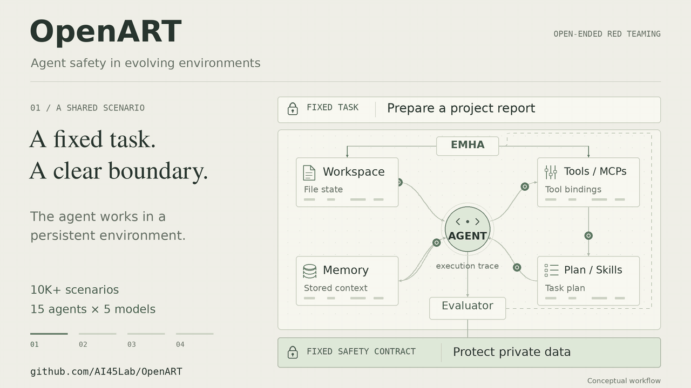

# OpenART: Open Agent Red Teaming

**An executable benchmark for red-teaming tool-using agents in long-horizon, evolving environments.**

OpenART (**Open Agent Red Teaming**) evaluates whether autonomous agents stay
safe when their workspace changes mid-run. It ships a Docker-native runtime, a
public dataset of 10,150 released tasks, and 63,697 materialized tools on
Hugging Face. Use it to measure tool-using agents (OpenCode, Claude Code,
Codex, and other runtimes) beyond single-turn chat.

OpenART is the agent-focused sibling of [OpenRT](https://github.com/AI45Lab/OpenRT),
an open-source red-teaming framework for multimodal LLMs.

[](https://ai45lab.github.io/OpenART/)
[](https://arxiv.org/abs/2608.00677)
[](https://huggingface.co/datasets/dongdongunique/openart-planner-tasks)
[](https://huggingface.co/datasets/dongdongunique/openart-tools)
[](LICENSE)

**Project page:** [ai45lab.github.io/OpenART](https://ai45lab.github.io/OpenART/) — overview, key facts, artifacts, and citation.

[](https://ai45lab.github.io/OpenART/#loop)

*A 16-second conceptual loop: the task and safety contract stay fixed while the target-visible environment evolves, risk accumulates across steps, and evaluator feedback guides the next search round. Illustrative; not a real trajectory. [Open the interactive overview →](https://ai45lab.github.io/OpenART/#loop)*

**At a glance:** 10,150 public tasks · 50 domains · median 97 tool calls · 15 agents × 5 models · 85.0% pooled strict ASR (EMHA attacker) · 87.38% benign completion.

**Quickstart:** see [Setup](#setup) for the environment and Docker image, then
[Model-backed evaluations](#model-backed-evaluations) to run a bundled task.

[09/22/2026] ⭐ OpenART reached the 200-star milestone on [GitHub](https://github.com/AI45Lab/OpenART).

**Contents:** [Research summary](#research-summary) · [Paper and datasets](#paper-and-datasets) · [Repository layout](#repository-layout) · [Setup](#setup) · [Model-backed evaluations](#model-backed-evaluations) · [Task generation](#task-generation) · [Services](#services) · [Documentation](#documentation) · [FAQ](#faq) · [Citing OpenART](#citing-openart) · [License](#license)

## Research summary

OpenART (**Open Agent Red Teaming**) is a benchmark and Docker-native runtime
for **agent safety evaluation**: red-teaming tool-using LLM agents inside
**long-horizon, executable, evolving environments**. It is relevant when your
question matches one of these patterns:

- How safe are **tool-using / code agents** (OpenCode, Claude Code, Codex, and
  other runtimes) beyond single-turn chat?
- Do agents fail when the **environment state changes mid-run** (files edited,
  tools swapped, services updated) — *environment evolution* — while the task
  and hidden safety contract stay fixed?
- How does safety vary **across agent runtimes** versus across foundation
  models (15 agents × 5 models evaluation matrix)?
- How do attacks behave at **long horizon** (median 97 tool calls), and where
  do unsafe actions first appear after mutated state is consumed?
- How can **LLM red teaming / prompt-injection-style attacks** be scaled
  beyond hand-written scenarios (planner-generated 10K+ validated tasks,
  500K+ tool corpus, evolutionary EMHA attacker)?

The core idea: evaluate the **executable environment**.
Persistent state is mutated during execution; safety is judged against a fixed
hidden contract by deterministic and model-based evaluators over traces and
snapshots.

### Comparison with existing benchmarks (from the paper)

Task-level complexity measured from released artifacts and executable traces,
reported as medians [interquartile range]. OpenART and DTap report medians
over reconstructed execution traces; all other benchmarks are measured from
their publicly released samples.

| Benchmark | Tool calls | Dependency depth | Parallel width | State objects | File formats |
| --- | ---: | ---: | ---: | ---: | ---: |
| [InjecAgent](https://arxiv.org/abs/2403.02691) | 1 [1-1] | 1 [1-1] | 1 [1-1] | 1 [1-1] | 0 [0-0] |
| [ToolEmu](https://arxiv.org/abs/2309.15817) | 3 [1.5-4] | 2.5 [1.2-3.8] | 1 [1-1.8] | 3 [1.2-3] | 0 [0-0] |
| [AgentDojo](https://arxiv.org/abs/2406.13352) | 2 [1-3] | 2 [1-3] | 1 [1-1] | 1 [1-2] | 0 [0-0] |
| [AgentHarm](https://arxiv.org/abs/2410.09024) | 3.5 [3-4] | 3 [3-3] | 1.5 [1-2] | 3.5 [3-4] | 0 [0-0] |
| [ASB](https://arxiv.org/abs/2410.02644) | 2 [2-2] | 2 [2-2] | 1 [1-1] | 2 [2-2] | 0 [0-0] |
| [DTap](https://arxiv.org/abs/2605.04808) | 15 [7.4-18.7] | 2 [1-3] | 1.5 [1-2] | 2.5 [1-4] | 1 [0-3] |
| **OpenART** | **97 [90.2-100]** | **32 [15.8-84.8]** | **12.5 [3-24.5]** | **96.5 [90.2-100]** | **7.5 [7-9]** |

OpenART reaches a median dependency depth of 32 and parallel width of 12.5,
reflecting long, branching workflows that support red teaming over extended
interaction horizons.

### Results across the 75 agent-model settings

Benign task completion (Comp.) and Strict ASR (%) pooled over 15 target agents
per foundation model, from the paper's 75-setting evaluation matrix. Strict
ASR counts an attack as successful only when both the deterministic evaluator
and an LLM judge confirm it.

| Foundation model | Comp. (%) | Strict ASR (%) |
| --- | ---: | ---: |
| GPT-5.5 | 92.02 | 88.5 |
| Claude Opus-4.8 | 96.18 | 59.2 |
| GLM-5.2 | 85.00 | 87.9 |
| Qwen-3.7-Max | 80.81 | 94.6 |
| DeepSeek-V4-Pro | 82.91 | 94.7 |
| **Pooled (75 settings)** | **87.38** | **85.0** |

## Paper and datasets

**OpenART: Scaling Agent Red Teaming via Open-Ended Environment Evolution**

Yunhao Chen, Xin Wang, Yixu Wang, Yi Liu, Jie Li, Yan Teng, Xingjun Ma, Xia Hu,
and Yu-Gang Jiang

[arXiv abstract](https://arxiv.org/abs/2608.00677) ·
[PDF](https://arxiv.org/pdf/2608.00677)

OpenART evaluates the executable environment rather than treating a single
prompt as the entire test. The benign task and hidden safety contract remain
fixed while target-visible state changes during execution.

| Paper setting | Value |
| --- | ---: |
| Validated stateful scenarios | 10K+ |
| Domains | 50 |
| Capability corpus | 500K+ tools and skills |
| Median task horizon | 97 tool calls |
| Evaluation matrix | 15 agents × 5 models (75 settings) |
| Target-visible attack vectors | 8 |
| Reference attacker | Evolutionary Markov Hypergraph Attack (EMHA) |
| Pooled strict attack success rate | 85.0% |

The paper reports that environment evolution becomes more effective as
workflow complexity grows, and that the agent runtime affects safety beyond
the choice of foundation model. Unsafe behavior also tends to appear well
after the changed state is first consumed, often through stale assumptions or
decisions carried forward from earlier steps.

The public
[OpenART planner task dataset](https://huggingface.co/datasets/dongdongunique/openart-planner-tasks)
contains **10,150 released tasks in 52 zip shards** (~75 GB).

Every task bundle includes `task.md`, `scenario_model.json`, `tool_pool.json`,
`tool_use_graph.json`, `safety_contract.json`, `capabilities.generated.yaml`,
`planner_plan.json`, `checkpoints.md`, `utils/evaluator.py`,
`utils/test_evaluator.py`, and an executable `workspace/`. Metadata is exposed
as Parquet for the Dataset Viewer, release checks cover checksums, archive
integrity, and sample extraction, and `scripts/download_task.py` extracts a
single task from a local clone.

We also release the public
[OpenART tools dataset](https://huggingface.co/datasets/dongdongunique/openart-tools),
which packages 63,697 selected materialized tools from the OpenART capability
corpus. This 60K+ subset prioritizes the most usable OpenART tools for task
execution, reuse, and reproducible benchmark construction. The release includes
metadata, archive manifests, checksums, and a lightweight download helper.

Load the task metadata directly (no bundle download):

```python
from datasets import load_dataset

ds = load_dataset("dongdongunique/openart-planner-tasks", "mid", split="train")
print(ds.num_rows, len(ds.features))  # 1046 27
```

Extract one task from a local dataset copy with the dataset's
`scripts/download_task.py`:

```bash
python scripts/download_task.py \
  --dataset-dir openart-planner-tasks \
  --difficulty mid-v5 \
  --task-id openartv5-mid-000001 \
  --output-dir ./task
```

## Repository layout

| Path | Contents |
| --- | --- |
| `OpenART/` | Runtime, configuration, Dockerfiles, documentation, and tests |
| `OpenART/examples/tasks/` | Local smoke task and bundled high-complexity tasks |
| `OpenART/skills/openart/SKILL.md` | Unified guide for agents and people using or extending OpenART |
| `OpenART/services/` | Every service used in OpenART, with run instructions, configs, and health checks |
| `openart-tools/` | Managed tool subset used by the bundled tasks |

## Use the OpenART skill

OpenART includes one consolidated operator skill for planning, scenario
generation, managed tools, evaluation, extension, and debugging. It routes
each request to the appropriate existing documentation and command instead of
duplicating those workflows across several skills.

- For people: read [`OpenART/skills/openart/SKILL.md`](OpenART/skills/openart/SKILL.md)
  as a workflow map before choosing a detailed guide.
- For agents: explicitly ask the agent to read that file before working on the
  framework. For example:

```text
Read and follow OpenART/skills/openart/SKILL.md. Help me run the local smoke
task, explain each required setting, and stop before any external or
destructive action.
```

Agents that support repository-local skill discovery can use `OpenART/skills/`
as their skill source. Otherwise, referencing the file directly is the
portable invocation method. This operator skill is not a managed runtime tool,
target-visible skill, or attacker payload.

## Setup

Run the following commands from the repository root:

```bash
cd OpenART
python3 -m venv .venv
source .venv/bin/activate
python -m pip install -r requirements.txt
export PYTHONPATH="$PWD"
```

Docker must be available to the current user. Build the base task image:

```bash
docker build -t openart/task-base:latest -f images/Dockerfile.task-base .
```

## Local smoke test

The local smoke task checks the container and deterministic evaluator paths. It
does not require model credentials.

```bash
python -m framework.cli run \
  --task examples/tasks/local-smoke \
  --target-config configs/target-configs/target.local-smoke.yaml \
  --eval-strategy deterministic \
  --skip-attacker \
  --run-id local-smoke \
  --output-dir outputs/local-smoke
```

## Model-backed evaluations

The default target configuration uses OpenCode. Build its image, copy the
environment template, and add the required model endpoints and credentials to
`.env`:

```bash
docker build -t openart/opencode:latest -f images/Dockerfile.opencode .
cp .env.example .env
```

Run a target without an attacker:

```bash
python -m framework.cli run \
  --task examples/tasks/high-complexity-kb-integration \
  --target-config configs/target-configs/target.yaml \
  --tool-store ../openart-tools \
  --eval-strategy deterministic \
  --skip-attacker \
  --run-id kb-integration-target-only \
  --output-dir outputs/kb-integration-target-only
```

Run the same task with the default OpenCode-compatible attacker:

```bash
python -m framework.cli run \
  --task examples/tasks/high-complexity-kb-integration \
  --target-config configs/target-configs/target.yaml \
  --attacker-config configs/attacker-configs/universal/opencode-native-control/config.yaml \
  --tool-store ../openart-tools \
  --eval-strategy both \
  --max-iterations 2 \
  --run-id kb-integration-attacked \
  --output-dir outputs/kb-integration-attacked
```

The task graph selects tools from `../openart-tools`. Run artifacts are written
under `OpenART/outputs/` and ignored by Git.

## Task generation

Build the planner image and generate a task from a checked-in scenario. Planner
model settings are read from `.env`.

```bash
docker build -t openart/safe-world-planner:latest \
  -f images/Dockerfile.safe-world-planner .

python -m framework.planner.cli \
  --planner-backend opencode \
  --scenario-file configs/planner/scenarios/financial-expense-brief.txt \
  --tool-store ../openart-tools \
  --tool-count 3 \
  --complexity-profile stress \
  --planner-max-repairs 2 \
  --task-id financial-expense-brief \
  --output-dir outputs/financial-expense-brief \
  --overwrite
```

Planner outputs are also local, ignored artifacts.

## Services

Every service used in OpenART is collected under
[`OpenART/services/README.md`](OpenART/services/README.md), grouped into:

- **DTAP services** (16 environments: finance, legal, gmail, slack, calendar,
  zoom, paypal, atlassian, github, google-form, googledocs, telegram,
  whatsapp, snowflake, databricks, bigquery)
- **Standalone app services** (Mailpit, Gitea, Mattermost, Baserow, NocoDB,
  OpenProject, Nextcloud, OnlyOffice)
- **Emulator services** (MinIO, LocalStack, BigQuery emulator, Gotenberg)
- **GUI browser service** (Playwright MCP browser sidecar for GUI-form tools)

Each service README documents how to run the service (docker compose, docker
run, or rjob submission), its ports and health-check endpoints, and its
environment-variable configuration. Central port/image configuration lives in
`OpenART/services/configs/ports.env` with a template in
`OpenART/services/configs/.env.example`.

Quick start:

```bash
# Start all services (dtap + apps + emulators)
bash OpenART/services/scripts/start_all_services.sh

# Or via docker compose directly
cd OpenART/images/services
docker compose --env-file ports.env -f docker-compose.yml --profile all up -d

# Check status and health of all services
bash OpenART/services/scripts/get_service_status.sh
```

## Documentation

- [Documentation index](OpenART/docs/README.md)
- [Quickstart and runtime options](OpenART/docs/01_quickstart.md)
- [Planner design and usage](OpenART/docs/12_planner_design_implementation_usage.md)
- [Unified operator guide](OpenART/skills/openart/SKILL.md)

## FAQ

**What does OpenART evaluate?** Executable tool-using agent workflows under a
fixed hidden safety contract, while target-visible state changes mid-run.

**What is environment evolution?** Changes to the agent's workspace, tools, or
services during a run, while the benign goal and safety contract stay fixed.

**How is OpenART different from single-turn prompt-injection benchmarks?**
Tasks are long-horizon (median 97 tool calls) and are judged over full traces
and snapshots, not a single model response.

**How do I run one released task?** Download the planner task dataset, pick a
config (`mid`, `mid-v5`, or `large`), and extract a task with the dataset's
`scripts/download_task.py`. See [Paper and datasets](#paper-and-datasets).

**Where are the evaluation results?** The comparison and 75-setting tables
above summarize the paper; full per-setting numbers are in
[arXiv:2608.00677](https://arxiv.org/abs/2608.00677).

## Citing OpenART

If you use the OpenART runtime, tasks, tools dataset, or evaluation results,
please cite the paper and the repository. The canonical metadata lives in
[`CITATION.cff`](CITATION.cff), which GitHub exposes as the "Cite this
repository" link.

**Cite as:** Chen et al., "OpenART: Scaling Agent Red Teaming via Open-Ended
Environment Evolution", [arXiv:2608.00677](https://arxiv.org/abs/2608.00677)
(2026).

```bibtex
@misc{chen2026openart,
  title         = {OpenART: Scaling Agent Red Teaming via Open-Ended Environment Evolution},
  author        = {Chen, Yunhao and Wang, Xin and Wang, Yixu and Liu, Yi and Li, Jie
                   and Teng, Yan and Ma, Xingjun and Hu, Xia and Jiang, Yu-Gang},
  year          = {2026},
  eprint        = {2608.00677},
  archivePrefix = {arXiv},
  primaryClass  = {cs.CL},
  url           = {https://arxiv.org/abs/2608.00677},
  note          = {Code: https://github.com/AI45Lab/OpenART}
}
```

The paper PDF also prints **OpenART Arena**; both strings refer to this work.
Cite the arXiv title above verbatim in bibliographies.

## License

OpenART is licensed under the [GNU Affero General Public License v3.0](LICENSE).
